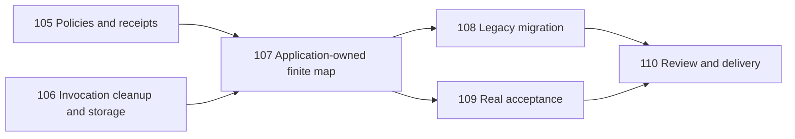

# Worker batch execution v1 task graph

Spec: [#104](https://github.com/linora-u/AgentLoom/issues/104).
Local contract: [worker-batch-execution-v1.md](worker-batch-execution-v1.md).
Integration branch: `codex/worker-batch-execution-v1`.
Fixed review baseline: `bc5cff6e61abf2a6d7ba7b0b6d2efac210463659`.
Code PR belongs to the private origin; closing references use the configured public issue tracker.

| Ticket | Dependencies | Deliverable |
| --- | --- | --- |
| [#105](https://github.com/linora-u/AgentLoom/issues/105) | None | typed policies, immutable receipts, strict validation and provenance |
| [#106](https://github.com/linora-u/AgentLoom/issues/106) | None | structured invocation/cleanup evidence, retained resource ownership, batch storage |
| [#107](https://github.com/linora-u/AgentLoom/issues/107) | #105, #106 | Application facade and complete BoundWorker.map contract |
| [#108](https://github.com/linora-u/AgentLoom/issues/108) | #107 | legacy adapters, actual maintained caller migration and docs |
| [#109](https://github.com/linora-u/AgentLoom/issues/109) | #107 | deterministic, real Runtime and supported-version acceptance evidence |
| [#110](https://github.com/linora-u/AgentLoom/issues/110) | #108, #109 | Standards/Spec review, fixes, completion audit and PR delivery |

Implementation tickets use isolated worktrees based on the integration branch. Implementers read TDD and
work in vertical slices through the agreed public seams. Merger agents integrate completed ticket branches.
The final review runs both axes independently; accepted findings are fixed through an implementer.

Shared Interface pointers for the first frontier:

- Public batch receipt/value exports live under `agentloom.execution.concurrency`; legacy TaskResult remains.
- `WorkItem(id, input)` owns a deeply immutable JSON snapshot. WorkPlan is a business value, not a Planner base.
- `ResolvedWorkerExecution` carries concurrency, source and ordered source chain from a single resolver.
- WorkerOutcome/BatchOutcome preserve ordered input identities, actual disposition, usage and cleanup evidence.
- Application facade and batch ownership belong in the Application module; the scheduler uses already-resolved policy.
- Structured invocation cleanup distinguishes ordinary invocation failure from incomplete cleanup.

This file is the dependency graph, not proof that any ticket is complete. Implementation status and evidence
are recorded in the final acceptance report and the linked PR.
